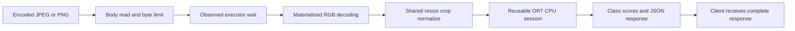

# Compact Vision Inference Service

A compact image-classification service and CPU inference study built with [TorchVision](https://github.com/pytorch/vision), [ONNX Runtime](https://github.com/microsoft/onnxruntime) and FastAPI. I built it to understand where inference requests spend time, verify model correctness across backends and measure whether changing CPU thread settings helps.

## What it does

- Uses frozen ImageNet features from **MobileNetV3-Small**, with only the last linear head trained for **CIFAR-10** classification.
- Shares checked RGB conversion, resizing, cropping and normalization across training, export, evaluation and serving.
- Verifies ONNX FP32 output parity and evaluates static per-channel INT8 quantization with training-only calibration. The full-CNN variant failed the quality threshold; the retained classifier-only INT8 variant keeps convolution in FP32.
- Serves raw JPEG/PNG bytes through FastAPI, reusing one explicitly configured ONNX Runtime CPU session per process.
- Measures body reading, executor wait, image decoding, preprocessing, model execution, postprocessing and serialization separately.
- Compares CPU thread settings with identical inputs and accounts for every scheduled request, including failures and timeouts.

This is a ten-class public-image demonstration, **not workshop-parts recognition or a production perception system**. Default subsets are 10,000 train, 2,000 validation, 2,000 official-test images, plus 128 training-only calibration inputs. CIFAR-10 images are 32×32, resized for the pretrained input. Near-duplicates and upstream pretraining overlap are not ruled out; results do not establish workshop/high-resolution camera quality or decoding cost.

See [STATUS.md](STATUS.md) for current status, [IMPROVEMENT_PLAN.md](IMPROVEMENT_PLAN.md) for the experiment design and acceptance rules, and [ATTRIBUTION.md](ATTRIBUTION.md) for upstream sources. Synthetic fixtures test request accounting; measured results come from the recorded model and HTTP runs.

## Verified native result

The FP32 model scored **1,738/2,000 (86.9%)** on the fixed test subset. On an M4 Pro running on battery power with a loopback client, changing ONNX Runtime intra-op threads from one to four reduced the median of three per-run client p95 latencies from **6.236 ms to 4.973 ms (20.3%)** at the nominal offered rate of **69.45 requests/s**, with no failures or generator drops. Energy use was not measured, and other machines or workloads need their own evaluation. See [the complete measured report](docs/RESULTS.md) for counts, variation, stage timings, the rejected quantization experiment and limitations.

For this measured local configuration, use `uv run compact-vision serve --threads 4`. The conservative one-thread baseline remains available for reproduction. Docker packaging is unverified on this host; no Docker engine is installed.

## Request path



Startup loads the session once. Server traces cover the declared handler/worker intervals; earlier dispatch and final network send remain outside that server boundary. Training, parity and serving share the input transformation in `compact_vision/preprocessing.py`.

## Run locally

Requires `uv` and Python 3.12. Run from the repository root. This command creates an isolated environment and installs locked packages:

```sh
uv sync --frozen
```

The build downloads the public CIFAR-10 archive and pretrained weights, selects fixed splits, trains the head on CPU, exports/checks FP32, attempts static quantization and evaluates validation quality. Data/weights remain ignored. It refuses to overwrite an existing checkpoint; choose a new artifact directory or use deliberate individual commands for a rebuild.

```sh
uv run compact-vision build
```

Start the loopback service after building. Startup loads artifacts; it performs no training or dataset download. Stop with Ctrl-C.

```sh
uv run compact-vision serve --backend fp32 --threads 1
```

In another terminal, inspect readiness or submit your own image as raw bytes (not multipart):

```sh
curl http://127.0.0.1:8000/health
curl -H 'Content-Type: image/jpeg' --data-binary @your-image.jpg http://127.0.0.1:8000/predict
```

Responses contain the top three class scores; softmax scores are not calibrated certainty. Invalid/oversized/unsupported input receives an explicit error. The `X-Compact-Trace` header contains server stage intervals; `/docs` exposes the API contract.

## Evaluate and measure

These commands create a real input trace, fresh-process model timings and a bounded loopback HTTP threading study. The study can take many minutes and stops its service afterward. New output directories are required for reruns so earlier evidence is preserved.

```sh
uv run compact-vision trace
uv run compact-vision benchmark
uv run compact-vision study
```

After methods/quality settings are frozen, explicitly score the untouched test subset:

```sh
uv run compact-vision evaluate --split test
```

Individual commands are `prepare`, `train`, `export`, `quantize`, `evaluate --split validation`. Configuration is [configs/demo.json](configs/demo.json); an alternate is passed before the command as `--config path.json`. Read [evaluation definitions](docs/evaluation.md) and [record schema](docs/measurement.md) before interpreting reports.

## Checks and container packaging

These validate implementation contracts, not model usefulness or performance:

```sh
uv run pytest -q
uv run ruff check .
```

The Dockerfile packages the ONNX service without training dependencies or bundled data/weights. Mount local generated artifacts; native and container measurements remain separate. Docker validation status is recorded in STATUS.md.

```sh
docker build -t compact-vision .
docker run --rm -p 127.0.0.1:8000:8000 -v "$PWD/models/demo:/models:ro" compact-vision
```

## Design and contribution

My work focuses on integrating the model and service, checking shared preprocessing and export parity, diagnosing time spent in each request stage, and evaluating a controlled CPU threading change. The model architecture, pretrained weights and inference/quantization algorithms come from the upstream projects credited in [ATTRIBUTION.md](ATTRIBUTION.md).

The experiment keeps correctness, model size and latency separate. Classifier-only INT8 reduced artifact size by **28.9%** but showed no meaningful model-only speedup. Four CPU threads improved request latency in the measured workload; higher parallelism also means competing for more CPU resources.

Private study notes are excluded from Git. The source, evaluation protocol, configurations and recorded results needed to inspect or reproduce the study are included in this repository.

To verify saved raw accounting and regenerate the results report without training or generating traffic: `uv run python -m scripts.report_results`.
