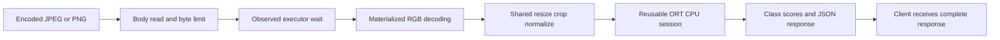

# Compact Vision Inference Service

A compact CPU classifier and inference-efficiency study using [TorchVision](https://github.com/pytorch/vision) and [ONNX Runtime](https://github.com/microsoft/onnxruntime). The owner authorized a fresh rebuild on 30 October 2026 because the other computer's code cannot be recovered. New results remain separate from earlier reported work.

## What it does

- Extract frozen ImageNet features with **MobileNetV3-Small**, then train only the last linear head for **CIFAR-10** public-image classification.
- Share one checked RGB/resize/crop/normalization contract across training, export, evaluation and serving.
- Export/verify ONNX FP32 and evaluate static per-channel QDQ with training-only calibration. The full-CNN variant failed its quality guard; the retained classifier-only INT8 variant keeps convolution FP32.
- Serve raw JPEG/PNG bytes through FastAPI and one explicitly configured CPU session loaded once per process.
- Measure decoding, preparation, model, postprocessing, body reading, serialization and observed executor wait.
- Compare one runtime-thread alternative fairly, preserving every scheduled request's outcome.

This is a ten-class public-image demonstration, **not workshop-parts recognition or a production perception system**. Default subsets are 10,000 train, 2,000 validation, 2,000 official-test images, plus 128 training-only calibration inputs. CIFAR-10 images are 32×32, resized for the pretrained input. Near-duplicates and upstream pretraining overlap are not ruled out; results do not establish workshop/high-resolution camera quality or decoding cost.

See [STATUS.md](STATUS.md) for verified progress/results, [IMPROVEMENT_PLAN.md](IMPROVEMENT_PLAN.md) for the contribution and frozen decision rules, and [ATTRIBUTION.md](ATTRIBUTION.md) for provenance. Synthetic fixtures are accounting checks, never inference results.

## Verified native result

The rebuilt FP32 model scored **1,738/2,000 (86.9%)** on the frozen test subset. On this M4 Pro/battery/loopback workload, changing ORT intra-op threads from one to four reduced nominal median client p95 from **6.236 ms to 4.973 ms (20.3%)** across three paired repeats, with no failures or generator drops. This changes CPU parallelism, not energy efficiency; new machines/workloads need their own check. See [the complete measured report](docs/RESULTS.md) for counts, variation, stage evidence, rejected quantization and limits.

For this measured local configuration, use `uv run compact-vision serve --threads 4`. The conservative one-thread baseline remains available for reproduction. Docker packaging is unverified on this host; no Docker engine is installed.

## Request path



Startup loads the session once. Server traces cover the declared handler/worker intervals; earlier dispatch and final network send remain outside that server boundary. Training, parity and serving share the input transformation in `compact_vision/preprocessing.py`.

## Run locally

Requires `uv` and Python 3.12. Run from the repository root. This command creates an isolated environment and installs locked packages:

```sh
uv sync --frozen
```

The build downloads the public CIFAR-10 archive and pretrained weights, selects fixed splits, trains the head on CPU, exports/checks FP32, attempts static quantization and evaluates validation quality. Data/weights remain ignored. It refuses to overwrite an existing checkpoint; choose a new artifact directory or use deliberate individual commands for a rebuild.

```sh
uv run compact-vision build
```

Start the loopback service after building. Startup loads artifacts; it performs no training or dataset download. Stop with Ctrl-C.

```sh
uv run compact-vision serve --backend fp32 --threads 1
```

In another terminal, inspect readiness or submit your own image as raw bytes (not multipart):

```sh
curl http://127.0.0.1:8000/health
curl -H 'Content-Type: image/jpeg' --data-binary @your-image.jpg http://127.0.0.1:8000/predict
```

Responses contain the top three class scores; softmax scores are not calibrated certainty. Invalid/oversized/unsupported input receives an explicit error. The `X-Compact-Trace` header contains server stage intervals; `/docs` exposes the API contract.

## Evaluate and measure

These commands create a real input trace, fresh-process model timings and a bounded loopback HTTP threading study. The study can take many minutes and stops its service afterward. New output directories are required for reruns so earlier evidence is preserved.

```sh
uv run compact-vision trace
uv run compact-vision benchmark
uv run compact-vision study
```

After methods/quality settings are frozen, explicitly score the untouched test subset:

```sh
uv run compact-vision evaluate --split test
```

Individual commands are `prepare`, `train`, `export`, `quantize`, `evaluate --split validation`. Configuration is [configs/demo.json](configs/demo.json); an alternate is passed before the command as `--config path.json`. Read [evaluation definitions](docs/evaluation.md) and [record schema](docs/measurement.md) before interpreting reports. Historical approximate speedups do not predict this rebuild's results.

## Checks and container packaging

These validate implementation contracts, not model usefulness or performance:

```sh
uv run pytest -q
uv run ruff check .
```

The Dockerfile packages the ONNX service without training dependencies or bundled data/weights. Mount local generated artifacts; native and container measurements remain separate. Docker validation status is recorded in STATUS.md.

```sh
docker build -t compact-vision .
docker run --rm -p 127.0.0.1:8000:8000 -v "$PWD/models/demo:/models:ro" compact-vision
```

## Ownership and learning

The personal contribution is checked shared preprocessing, honest stage/outcome accounting and a defensible configuration decision, not invention of MobileNet/ONNX/quantization. Private lessons in Git-ignored `.learning/` start with terminal/Python/image basics, proceed through actual source and experiments, and keep exercises, progressive hints and answer checks separate. They are privately backed up and do not accompany a clone. Public configs, definitions, commands and selected evidence remain outside that folder. No employer/lab assets are used.

To verify saved raw accounting and regenerate the results report without training or generating traffic: `uv run python -m scripts.report_results`.
